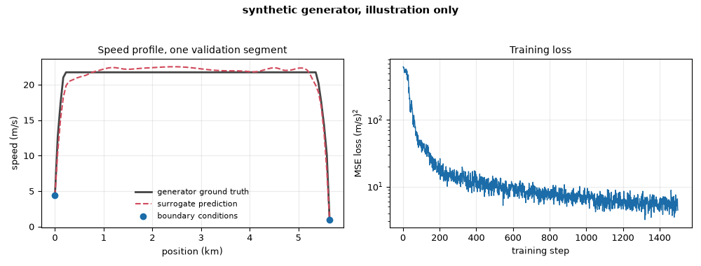
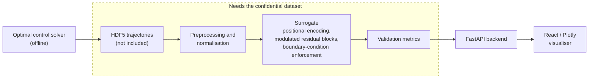

# train-speed-profile-surrogate

*Neural surrogate for energy-optimal train speed profiles, with millisecond inference on CPU.*

[](https://github.com/thelordofpigeons/train-speed-profile-surrogate/actions/workflows/ci.yml)
[](LICENSE)
[](pyproject.toml)
[](https://pytorch.org)
[](docs/dataset_and_nda.md)

## At a glance

- **Problem.** An optimal control solver needs seconds to minutes per trajectory. Automatic Train Operation (ATO), Driver Advisory Systems (DAS) and replanning after a disturbance need milliseconds.
- **Approach.** A PyTorch surrogate is trained offline on solver output and replaces the solver at run time. It uses physics-informed losses and hard boundary conditions.
- **Reported result.** RMSE 0.20 m/s against the optimal solution, peak error 0.26 m/s, inference under 10 ms on a CPU.
- **Data.** The training data is confidential and under a non-disclosure agreement (NDA). It is not in this repository.

The work was done in a project with the LAMIH laboratory of the Universite Polytechnique Hauts-de-France (UPHF). The repository contains the model, the losses, the training and validation code, a replanning demo and a web visualiser.

## Synthetic example



*Generated by the synthetic path of this repository (1500 CPU steps, about 10 seconds). Left: one validation segment from the kinematic generator, ground truth against the surrogate prediction, with the exact start and end speeds marked. Right: training loss. This is the reduced synthetic setup and says nothing about accuracy on real railway data.*

## The dataset is not included

**The training data is confidential and is not in this repository.** It is a set of optimal trajectories computed for real railway infrastructure and covered by a non-disclosure agreement. Because it cannot be shared, the repository also contains no trajectories, no train/validation split files, no normalisation statistics, no trained checkpoints and no plots rendered from the data. Weights fitted to the data count as part of the data.

- You can read, test and run the model code, and train it on a synthetic generator (quick start below). That run shows the mechanics. It does not reproduce the reported accuracy.
- Real-data training, validation, the CLI demo and the web visualiser need an HDF5 dataset of your own in the layout described in [docs/dataset_and_nda.md](docs/dataset_and_nda.md). The last two also need a trained run.
- The numbers quoted below come from the author's report and cannot be checked from this repository.

## Results reported by the author

Measured on a held-out validation set of the confidential dataset, as stated in the report:

| Quantity | V4 model |
| --- | --- |
| Mean RMSE against the optimal solution | 0.20 m/s |
| Peak velocity error | 0.26 m/s |
| Boundary conditions (start and end speed) | exact by construction |
| Inference time | under 10 ms on a standard CPU, under 5 ms on a modern GPU |

The baseline in the report (V1), a plain network regressing the profile with no physical constraints and no track conditioning, had RMSE up to 33 m/s, with worst cases above 30 m/s, and violated the boundary conditions. V4 changed four things at once: hard boundary conditions, physics-informed loss terms, track-feature conditioning and a deeper residual network. The report does not separate their individual effects.

## How it works



The model is coordinate-based. For a segment between two stops it predicts the speed at a normalised position `xi = (x - x0) / (xf - x0)`, given the operating conditions, so the whole profile is one batched forward pass.

- **Positional encoding.** `xi` is expanded into sines and cosines at 16 geometrically spaced frequencies, so the network can represent sharp changes between acceleration, cruise, coast and braking.
- **Conditioning.** Six continuous values (segment length, start speed, end speed, target duration, train mass, speed cap), two learned station embeddings, and 26 track features: slope, speed limit and curvature sampled at seven relative lookahead offsets, plus five signals about upcoming speed-limit drops.
- **Modulated residual blocks.** The V4 configuration stacks 8 blocks of width 256, about 0.6 million parameters (602,099, roughly 2.4 MB in float32, counted by instantiating the model with that configuration). Each block computes `h + A(h) * B(P)`: a SiLU layer on the hidden state, scaled by a projection of the conditioning vector.
- **Hard boundary conditions.** The output is built as `v(xi) = (1 - xi) v0 + xi vf + xi (1 - xi) y(xi)`, where `y` is the raw network output. Start and end speed are therefore exact for any weights, and the loss does not have to teach them.
- **Physics-informed training.** Besides the speed error, the V4 loss penalises curvature of the profile, speed-limit violations, negative speeds, an energy proxy `(v dv/dx)^2 v`, traction power from the Davis resistance equation, and an optimality residual. These terms are phased in after a warm-up.
- **Point and trajectory batches.** Random-position batches carry most of the optimisation. At intervals the loop switches to full ordered trajectories, which is where the derivative-based terms can be computed.

Details, formulas and the places where the code differs from the report are in [docs/technical_notes.md](docs/technical_notes.md).

## Quick start on synthetic data

Requires Python 3.12. No dataset is needed, and none of the tests uses one: they use random tensors or a small mock HDF5 file written to a temporary directory.

```bash
python -m venv .venv
# Linux / macOS:           source .venv/bin/activate
# Windows PowerShell:      .venv\Scripts\Activate.ps1
# Windows Git Bash:        source .venv/Scripts/activate
pip install torch --index-url https://download.pytorch.org/whl/cpu
pip install -r requirements.txt
pip install -e .
python -m pytest -q
python scripts/train_synthetic.py --steps 200
python scripts/benchmark_inference_cpu.py   # timing on your machine, not the report's
```

`utils/data_gen.py` produces kinematic acceleration, cruise and braking profiles with random length, speed cap, acceleration limits and mass. The script trains the same `SpeedProfileGenerator` class on them on the CPU, in a reduced setup:

- The model is smaller than the V4 configuration (width 64, 4 blocks, see `configs/synthetic_smoke.yaml`).
- There are no track features and no station ids. The six-value conditioning vector is filled from the generator's parameters.
- The loss is plain mean squared error. None of the physics terms is used.
- The reference is a kinematic profile, not an optimal control solution.

The loss falls during training and the start and end speeds come out exact (the script prints the largest boundary error on a validation set). Checkpoints go to `runs/synthetic/` by default, which is git-ignored. Run `python scripts/train_synthetic.py --help` for the options. The benchmark uses random inputs at the V4 model size.

## Real data layout

```bash
python -m speed_profile_generator.training.train_h5 --config configs/train_h5_config_v4_full.yaml
python -m speed_profile_generator.validation.validate_h5 --run_dir runs/run_<timestamp>
```

Set `data.h5_path` in the configuration first. Training falls back to CPU when CUDA is unavailable. On a CPU-only machine also set `num_workers: 0`, `pin_memory: false` and `use_amp: false` in the config. The expected file layout and the conversion script for MATLAB exports (`scripts/mat_to_h5.py`) are in [docs/dataset_and_nda.md](docs/dataset_and_nda.md). `configs/train_h5_config_v3_full.yaml` is the previous baseline, and `configs/ablations/` holds the intermediate V3 loss variants.

The CLI demo loads a trajectory, plans a profile with the model, simulates a train tracking it, injects a disturbance, replans at that moment and renders the result (MP4 output needs FFmpeg). It needs a dataset and a trained run, so it returns nothing useful on a fresh clone.

```bash
python -m demo.app --scenario speed_limit --run_dir runs/run_<timestamp> --h5_path path/to/dataset.h5
```

Scenarios are `stop`, `speed_limit`, `traction_loss` and `none`; see [demo/README.md](demo/README.md).

## Web visualiser

A FastAPI backend with a React, Vite and Plotly frontend. It shows planned, executed and reference speed against position and time, the acceleration limits, disturbance and replan markers, and simple KPIs. Like the demo, it needs a dataset and a trained run. Build the frontend from source (no bundle is committed) and start the server as described in [src/speed_profile_generator/webapp/README_WEBAPP.md](src/speed_profile_generator/webapp/README_WEBAPP.md).

## Repository layout

```
configs/                    training configurations (V4, V3 baseline, ablations)
demo/                       replanning simulator and CLI demo
docs/                       technical notes, dataset and confidentiality notes
scripts/                    synthetic training, benchmark, MAT-to-HDF5 conversion,
                            frontend build scripts
src/speed_profile_generator/
  models/                   network, modulated blocks, positional encoding
  training/                 train_h5.py, losses_v3.py, train_synthetic.py
  data/                     HDF5 dataset loader, synthetic dataset
  utils/                    hard boundary conditions, preprocessor, data generator
  validation/               metrics and validation reports
  reporting/                PDF report generation
  webapp/                   FastAPI backend and React frontend source
tests/                      unit tests, no dataset required
```

## Limitations

- The network approximates a solver. It gives no optimality guarantee, and only the start and end speeds are exact.
- Speed limits, acceleration limits and non-negative speed are penalised in training, not guaranteed. A deployed system would need a check or a projection step after inference.
- Accuracy depends on the diversity of the training trajectories. Nothing here covers unseen trains, tracks or conditions beyond what the report describes.
- This is a decision-support model, not a safety-critical controller. Final authority stays with certified train control.
- Hardware-in-the-loop tests, field trials and the traceability requirements of the European AI Act are future work in the report, and are not done here.

## Citation

If you build on this work, please cite the report it accompanies; see [CITATION.cff](CITATION.cff).

> M. A. Karcha, *AI-Based Energy-Optimal Train Speed Profile Generation Using Neural Surrogate Modeling for Real-Time Railway Systems*, 2026.

## License

MIT for the code and documentation, see [LICENSE](LICENSE). The license does not cover the confidential dataset, which is not included; see [NOTICE](NOTICE).
